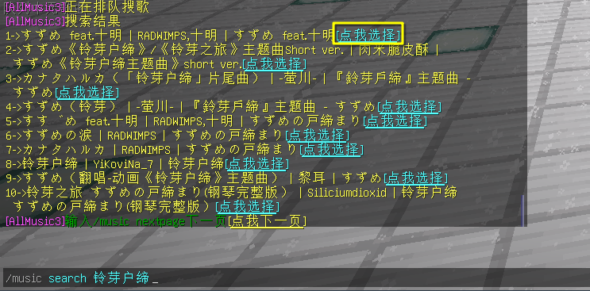
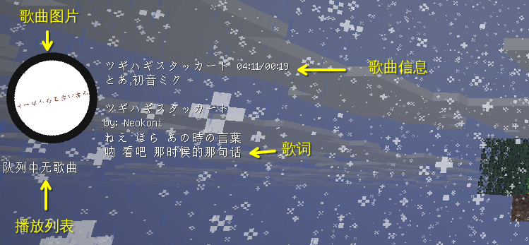

# 全局点歌

`AllMusic` 让同一子服务器内安装了客户端 mod 的玩家共同收听同一首歌。插件运行在 Velocity 代理端，播放列表在子服务器之间同步。

开源地址：[AllMusic](https://github.com/Coloryr/AllMusic)

适用子服务器：`Lights`

::: info
仅 Java 版支持，需要安装客户端 mod。
:::

## 安装客户端 mod

从 [AllMusic Releases](https://github.com/Coloryr/AllMusic/releases) 下载与客户端版本、mod 加载器匹配的 `AllMusic_Client` 构建，放入客户端的 `mods` 目录。

文件按 `加载器-版本.AllMusic_Client-*.jar` 命名，例如 `fabric-26.2.AllMusic_Client-4.3.0.jar`。若无法连接服务器，改用与服务器插件版本一致的构建。

## 点歌

### 搜索点歌

```text
/music search <歌名>
```

搜索结果中点击「点我选择」加入播放列表。



### 按歌曲 ID 点歌

歌曲 ID 是网易云音乐中每首歌的唯一标识，可从分享链接中获取：

```text
https://music.163.com/#/song?id=1879098277
```

其中 `song?id=` 后的 `1879098277` 即歌曲 ID。

```text
/music 1879098277
```

也可以直接粘贴网易云分享链接。

## 界面设置

界面默认显示在左上角，由四个模块组成：`info`（歌曲信息）、`list`（播放列表）、`lyric`（歌词）、`pic`（歌曲图片）。

### 开关模块

- `/music hud enable` 开关全部界面
- `/music hud <模块> enable` 开关单个模块

示例：`/music hud pic enable`



### 设置位置

可用位置：`BOTTOM_CENTER`、`BOTTOM_LEFT`、`BOTTOM_RIGHT`、`CENTER`、`LEFT`、`RIGHT`、`TOP_CENTER`、`TOP_LEFT`、`TOP_RIGHT`。

```text
/music hud <模块> dir <位置>
```

微调坐标：

```text
/music hud <模块> pos <x> <y>
```

### 重置

- `/music hud <模块> reset` 重置单个模块
- `/music hud reset` 重置全部模块

## 播放控制

- `/music stop` 停止播放
- `/music cancel [序号]` 取消自己已点但未播放的歌曲
- `/music mute` 不再接收点歌，再次执行恢复
- `/music vote` 发起切歌投票
- `/music vote cancel` 取消切歌投票

## 指令一览

::: info
转载自 [AllMusic_Server](https://github.com/Coloryr/AllMusic_Server?tab=readme-ov-file#%E6%8C%87%E4%BB%A4%E8%AF%B4%E6%98%8E)
:::

- `/music [音乐ID/网易云分享链接]` 点歌
- `/music stop` 停止播放歌曲
- `/music list` 查看歌曲队列
- `/music cancel [序号]` 取消自己的点歌
- `/music vote` 投票切歌
- `/music vote cancel` 取消发起的切歌
- `/music push [序号]` 投票将歌曲插入队列头
- `/music push cancel` 取消发起的插歌
- `/music mute` 不再参与点歌，再次输入恢复
- `/music mute list` 不接收空闲列表点歌，再次输入恢复
- `/music search [歌名]` 搜索歌曲
- `/music select [序号]` 选择歌曲
- `/music nextpage` 切换到下一页搜索结果
- `/music lastpage` 切换到上一页搜索结果
- `/music hud enable` 启用或关闭全部界面
- `/music hud reset` 重置全部界面
- `/music hud [模块] enable` 启用或关闭单个界面
- `/music hud [模块] pos [x] [y]` 设置界面位置
- `/music hud [模块] dir [对齐方式]` 设置界面对齐方式
- `/music hud [模块] color [颜色HEX]` 设置界面颜色
- `/music hud [模块] reset` 重置单个界面
- `/music hud pic size [尺寸]` 设置图片尺寸
- `/music hud pic rotate [开关]` 设置图片旋转模式
- `/music hud pic speed [数值]` 设置图片旋转速度
