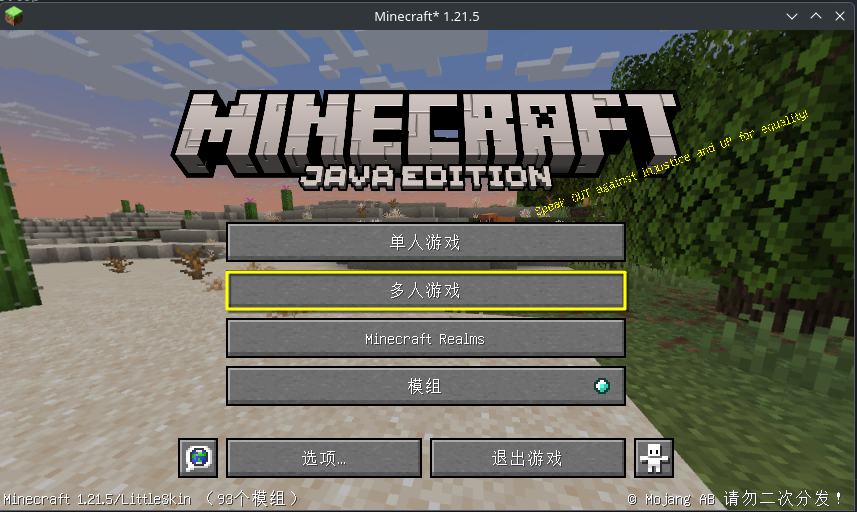
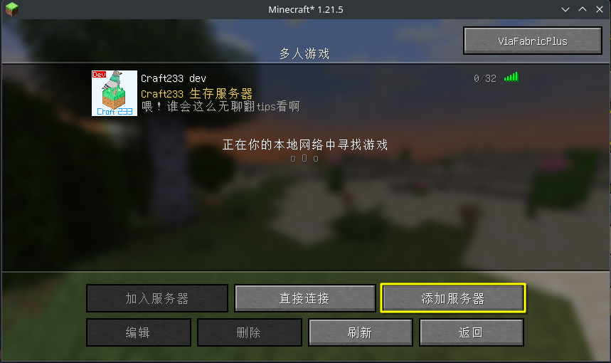
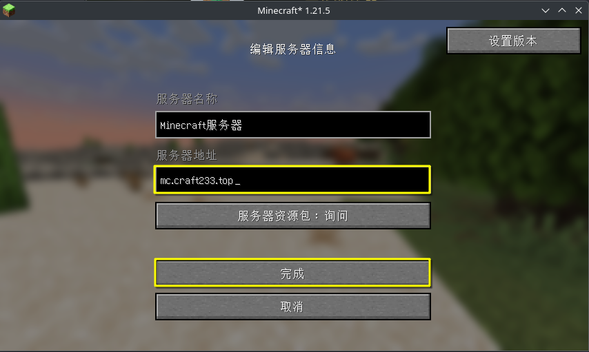

# 正式进入🧭

## 服务器地址

Craft233 提供以下连接地址，端口均为默认的 `25565`，无需填写。

| 地址 | 说明 |
| --- | --- |
| `mc.craft233.cn` | 默认地址，由 DNS 自动选择可用中转线路 |
| `frp.mc.craft233.cn` | FRP 中转线路 |
| `frp-oversea.mc.craft233.cn` | 海外中转线路 |
| `dir.mc.craft233.cn` | 直连线路，解析至服务器当前公网 IP |

连接延迟异常时，依次尝试其他地址。直连线路使用动态公网 IP，重新拨号后 DNS 记录同步存在延迟。

服务器在线状态以 [Craft233 状态监测站](https://status.craft233.cn) 为准。

## Java 版添加服务器

1. 启动游戏，进入「多人游戏」。
2. 点击「添加服务器」。
3. 在「服务器地址」中填入上表任一地址。
4. 保存后双击进入。

验证客户端版本在 `1.21.x` 至 `26.2` 之间。版本不匹配时，服务器列表会提示不兼容。

## 截图参照

### Java 版

