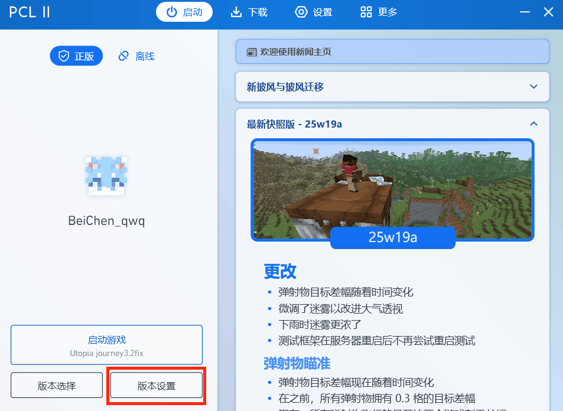
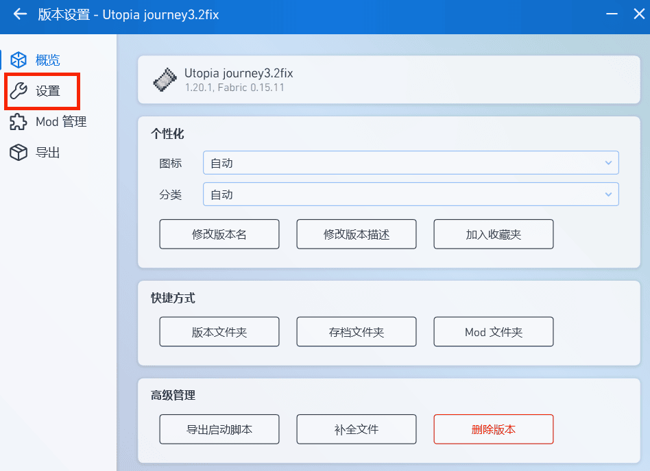
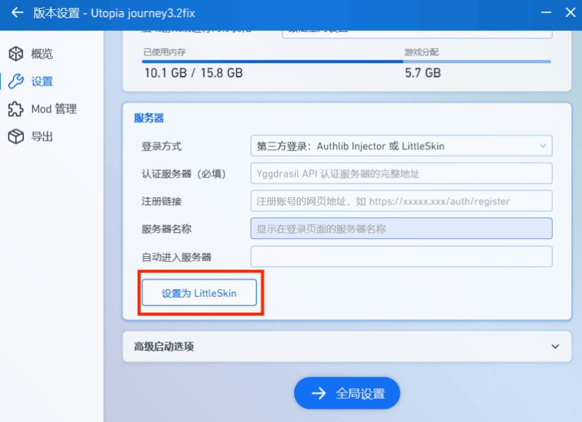

# 准备账号🌏

Craft233 使用 `MultiLogin` 提供外置验证登录，接入以下两种账号：

- 微软正版验证
- LittleSkin 外置登录

同一游戏名不能被多个平台同时占用。需要使用其他平台登录时，联系管理员将该平台 UUID 链接到原账号。

::: info
游戏名须匹配 `^[0-9a-zA-Z_]{3,16}$`，即 3 至 16 位字母、数字或下划线。含空格或其他字符的名称无法通过验证。
:::

## 微软正版登录

在启动器中登录已购买 Minecraft 的微软账号，随后直接启动游戏。

::: info
无法加载验证码时，使用游戏加速器加速微软相关服务，或更换网络环境后重试。
:::

## LittleSkin 外置登录

1. 打开 [LittleSkin](https://littleskin.cn) 注册账号并创建角色。
2. 在启动器中添加账户，选择「外置登录」或「LittleSkin」。
3. 填入 LittleSkin 账号信息。

LittleSkin Yggdrasil API：

```text
https://littleskin.cn/api/yggdrasil
```

- HMCL 配置参考 [LittleSkin 用户使用手册](https://manual.littlesk.in/yggdrasil/client)。
- PCL 配置：选择「设置为 LittleSkin」后填入账号信息。

::: info
PCL 截图由 [BeiChen 北尘](https://www.beichen.icu) 提供。
:::







## 更换登录方式

同一游戏名已绑定某一平台时，MultiLogin 会提示名称已被占用。需要改用其他平台登录时，联系管理员将该平台 UUID 链接到原账号。链接不要求两个平台使用相同游戏名。
